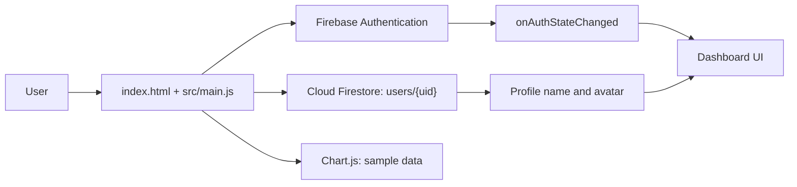

# AuthLab — A Firebase-powered authentication and analytics dashboard

>   

## 📑 Table of Contents

- [1. 📌 Overview](#1--overview)
- [2. ✨ Features](#2--features)
- [3. 🛠 Tech Stack](#3--tech-stack)
- [4. 🏗 How It Works / Architecture](#4--how-it-works--architecture)
- [5. 📁 Project Structure](#5--project-structure)
- [6. 🚀 Getting Started](#6--getting-started)
- [7. 🔑 Usage Guide](#7--usage-guide)
- [8. 🔌 API Routes / Pages](#8--api-routes--pages)
- [9. 🗄 Database Schema](#9--database-schema)
- [10. 🧪 Testing & Troubleshooting](#10--testing--troubleshooting)
- [11. 📸 Screenshots](#11--screenshots)
- [12. 🚢 Deployment](#12--deployment)
- [13. 🔮 Future Improvements](#13--future-improvements)
- [14. 👨‍💻 Author + License](#14--author--license)

## 1. 📌 Overview

AuthLab is a browser-based authentication dashboard. Firebase Authentication manages accounts, Firestore stores each user's profile, and the dashboard displays sample analytics.

**Highlights:** email/password auth; editable profile; responsive dashboard; local-time greeting; theme toggle; Chart.js visualizations.

## 2. ✨ Features

### Auth
- ✅ Register with email and password; send a verification email.
- ✅ Sign in and respond to Firebase authentication state changes.
- ✅ Reset a forgotten password and resend verification email.
- ✅ Sign out using Firebase Auth.
- ✅ Show a verification notice for unverified accounts; the notice does not block the dashboard.

### Dashboard
- ✅ Responsive dashboard shell, sidebar navigation, search over activity rows, and sample KPI cards.
- ✅ Light/dark theme preference saved in browser local storage.
- ✅ Greeting based on the browser's local hour, with a matching time icon.

### Profile
- ✅ Load or initialize a Firestore user profile.
- ✅ Save a display name to Firebase Auth and Firestore.
- ✅ Save an avatar choice to Firestore.

### Analytics
- ✅ Revenue line chart with 7-day and 30-day sample series.
- ✅ Traffic-source doughnut chart with sample percentages.
- 🚧 KPI values, activity entries, and chart series are hardcoded sample data, not live business analytics.

### Other
- ✅ Responsive sidebar/logout control and keyboard focus styling.
- ✅ Accessible status messages for authentication, profile, and chart errors.

## 3. 🛠 Tech Stack

| Layer | Technology | Purpose |
|---|---|---|
| UI | HTML5 and CSS | Authentication screens, dashboard, responsive layout, and themes |
| Application | JavaScript ES modules | UI events, authentication state, profile updates, and dashboard logic |
| Build/dev server | Vite 8 | Local development and production bundling |
| Authentication | Firebase Authentication | Email/password accounts, verification, reset, and sign-out |
| Database | Cloud Firestore | Per-user profile documents |
| Charts | Chart.js 4 | Revenue and traffic visualizations |

## 4. 🏗 How It Works / Architecture

### Application flow

1. Vite serves `index.html`; `src/main.js` loads the styles, UI handlers, and Firebase client initialized in `src/firebase.js`.
2. Auth actions call Firebase Authentication from the browser. `onAuthStateChanged` selects the login or dashboard view.
3. The dashboard reads and writes profile data at `users/{uid}` in Firestore.
4. Chart.js renders sample data defined in the frontend; there is no app server or analytics API.



### Authentication flow

- **Register/login:** Firebase creates or authenticates an email/password account; registration triggers a verification email.
- **Verification/reset:** A notice and resend action are shown for unverified users, but verification does not gate the dashboard. Password reset uses Firebase email delivery.
- **Logout:** `signOut(auth)` ends the Firebase sign-in state. There are no app-defined session or JWT routes.

### Dashboard data

- Greeting uses local `new Date().getHours()`; profile name/avatar come from Firebase Auth and Firestore.
- KPI figures, activity rows, traffic breakdown, and revenue points are static sample content.
- The sidebar collapses off-canvas on narrow screens; mobile logout is icon-only with a native title tooltip.

## 5. 📁 Project Structure

```text
authlab/
├── index.html              # Authentication and dashboard markup
├── package.json            # Dependencies and npm scripts
├── package-lock.json       # Locked dependency tree
├── firestore.rules         # Per-user Firestore access rule
├── .gitignore              # Ignores dependencies, builds, and local files
├── README.md               # Project documentation
├── public/                 # favicon.svg and icons.svg
└── src/
    ├── firebase.js         # Firebase app, Auth, and Firestore initialization
    ├── main.js             # Authentication, profile, dashboard, and chart logic
    ├── style.css           # Authentication and dashboard styles
    └── assets/              # hero.png, javascript.svg, and vite.svg
```

`dist/` and `node_modules/` are generated by the build and install steps and are excluded by `.gitignore`.

## 6. 🚀 Getting Started

### Prerequisites

- Node.js `^20.19.0` or `>=22.12.0` (Vite 8's declared engine requirement).
- npm.
- A Firebase project with Email/Password Authentication and Cloud Firestore enabled.

### Installation

```bash
npm install
npm run dev
```

On a fresh checkout, copy `.env.example` to `.env` and fill in the Firebase web app settings before starting the dev server. In Windows PowerShell use `Copy-Item .env.example .env`; in macOS/Linux/Git Bash use `cp .env.example .env`. Enable Email/Password Authentication and Cloud Firestore and configure authorized domains in Firebase.

### Environment Variables

The local `.env` is ignored by Git. Vite exposes `VITE_*` settings to browser code, so these Firebase web-app values are configuration identifiers, not private server secrets. Never put service-account credentials, private keys, or other secrets in `VITE_*` variables or frontend code. Firestore rules and Firebase service restrictions must protect data and APIs.

| Variable | Required | Example | Description |
|---|---|---|---|
| `VITE_FIREBASE_API_KEY` | Yes | `your-firebase-web-api-key` | Firebase web app API key |
| `VITE_FIREBASE_AUTH_DOMAIN` | Yes | `your-project-id.firebaseapp.com` | Firebase Authentication domain |
| `VITE_FIREBASE_PROJECT_ID` | Yes | `your-project-id` | Firebase project identifier |
| `VITE_FIREBASE_STORAGE_BUCKET` | Yes | `your-project-id.firebasestorage.app` | Firebase Storage bucket |
| `VITE_FIREBASE_MESSAGING_SENDER_ID` | Yes | `your-messaging-sender-id` | Firebase messaging sender identifier |
| `VITE_FIREBASE_APP_ID` | Yes | `your-firebase-app-id` | Firebase web app identifier |
| `VITE_FIREBASE_MEASUREMENT_ID` | No | `your-measurement-id` | Optional measurement identifier |

### Run Commands

| Command | What it does |
|---|---|
| `npm install` | Installs dependencies from `package-lock.json`. |
| `npm run dev` | Starts the Vite development server. |
| `npm run build` | Builds the static production site into `dist/`. |
| `npm run preview` | Serves the production build locally; run `npm run build` first. |

## 7. 🔑 Usage Guide

1. Select **Create Account**, enter an email/password, confirm it, and submit; the app sends a verification email.
2. Sign in with an existing account or use **Forgot password?** to request a reset email.
3. The authenticated dashboard shows a verification notice for unverified accounts.
4. Navigate with the sidebar, filter activity with search, and change the theme from the dashboard controls.
5. Use **Edit profile** to save a display name/avatar; select **Logout** or **Sign out** to end the session.

The greeting uses local browser time: **05:00–11:59** morning, **12:00–16:59** afternoon, and **17:00–04:59** evening. It includes the saved profile name when available and uses a sunrise, sun, or moon icon. The sidebar moves off-canvas on smaller screens; its logout button is icon-only at mobile breakpoints, remains at least 44px tall/wide, and has an accessible `Logout` label.

## 8. 🔌 API Routes / Pages

There are no app-defined HTTP API routes or server-side page routes. Auth and database operations use the Firebase client SDK.

| Method | Route / target | Auth? | Description |
|---|---|---|---|
| Page | `/` | No | Single-page app entry in `index.html`; shows login/register or dashboard based on Firebase auth state. |
| UI section | `#dashboard` | Yes (dashboard view) | Dashboard overview. |
| UI section | `#analytics` | Yes (dashboard view) | Revenue and traffic charts. |
| UI section | `#users` | Yes (dashboard view) | Top-performer sample content. |
| UI section | `#orders` | Yes (dashboard view) | Activity table; the search field filters its rows. |
| UI section | `#activity` | Yes (dashboard view) | Recent activity content. |
| UI control | `#profile-settings` | Yes (dashboard view) | Profile editor for display name and avatar. |

## 9. 🗄 Database Schema

The only application collection evidenced in the code and `firestore.rules` is `users`.

| Collection/document | Fields | Description |
|---|---|---|
| `users/{uid}` | `displayName` (string), `avatar` (string), `updatedAt` (server timestamp) | One profile document per Firebase Authentication UID. Created with profile defaults when first loaded; profile edits merge fields into it. |

`firestore.rules` allows a signed-in user to read/write only `users/{uid}` where `{uid}` equals `request.auth.uid`. No separate models or schema migration files are present.

## 10. 🧪 Testing & Troubleshooting

There is no test script or test suite configured in `package.json`. Run the available production build as a smoke check:

```bash
npm run build
```

| Problem | Suggested fix |
|---|---|
| `auth/network-request-failed` or Firebase requests fail | Check network access, Firebase project configuration in `src/firebase.js`, and that the required Firebase services are enabled. |
| `auth/too-many-requests` | Wait before retrying; Firebase may temporarily throttle repeated authentication attempts. |
| `auth/weak-password` | Enter a password meeting Firebase's password policy; the UI requires at least 6 characters. |
| Firestore `permission-denied` while loading/saving profile | Deploy/check `firestore.rules`; confirm the signed-in UID matches the `users/{uid}` document path. |
| Verification email is not delivered | Check the account email, spam folder, Firebase email templates, and authorized domain configuration. |

## 11. 📸 Screenshots

Add project screenshots to the repository and replace these placeholders:

| Screen | Preview |
|---|---|
| Dashboard | [TODO: add dashboard screenshot](./screenshots/dashboard.png) |
| Authentication | [TODO: add authentication screenshot](./screenshots/authentication.png) |

## 12. 🚢 Deployment

Build the static site before deployment:

```bash
npm run build
```

The production files are written to `dist/`. Configure Firebase Auth's authorized domains for the deployed hostname and deploy the Firestore rules from `firestore.rules`.

- **Render:** Create a Static Site. Set the project root to this app's directory, build command to `npm run build`, and publish directory to `dist`.
- **Vercel:** Import the project as a Vite/static frontend. Set the root directory to this app, build command to `npm run build`, and output directory to `dist`.
- **cPanel:** Build locally and upload the contents of `dist/` to the domain's document root.

No backend server or API deployment is defined in this project. [TODO: confirm deployment host, production Firebase configuration strategy, and production domain.]

## 13. 🔮 Future Improvements

1. Replace sample dashboard data with live, authorized analytics data.
2. Keep Firebase web configuration environment-specific and document its required `VITE_*` variables.
3. Add automated unit and browser-level tests for auth, profile, and responsive layouts.
4. Add account recovery/verification UX, loading states, and clearer handling for auth edge cases.
5. Add CI checks and deployment configuration for the chosen hosting provider.

## 14. 👨‍💻 Author + License

- **App:** AuthLab (`package.json` name: `authlab`).
- **Author:** The page footer credits “its Lukii.” [TODO: confirm preferred author name and profile link.]
- **License:** [TODO: confirm license; no license file or package license field was found.]

### Items to confirm

- [TODO: confirm] License and author details.
- [TODO: confirm] Whether Firebase configuration should be provided through `VITE_*` environment variables.
- [TODO: confirm] Production hosting provider/domain and screenshot locations.
- [TODO: add] Automated test suite; none is declared in the current npm scripts.
